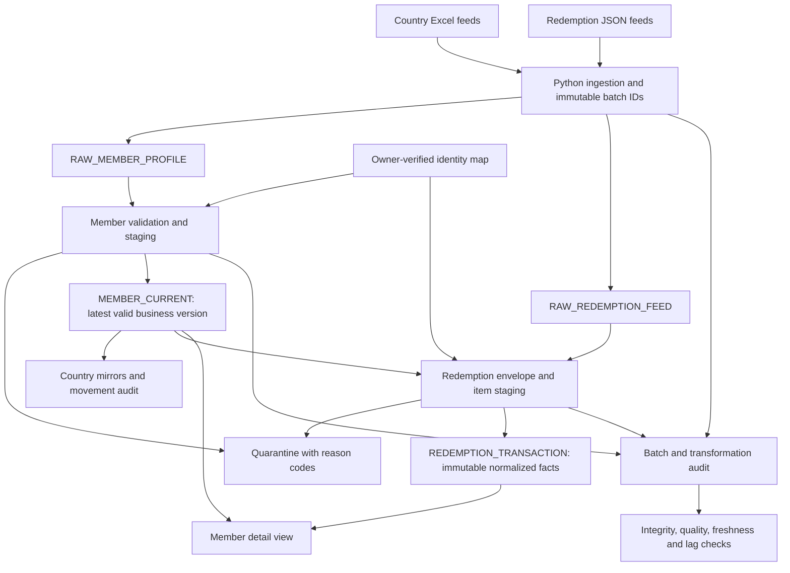

# SkyPoints assessment submission guide

Repository: [vishwas232/skypoints-data-engineering](https://github.com/vishwas232/skypoints-data-engineering).
Latest verified implementation commit: `9a05bb5` (18 November 2026).

The project implements a bounded Excel/JSON-to-Snowflake pipeline with immutable
RAW, validation/quarantine, verified member identity resolution, current-member
and country maintenance, redemption processing, and operational checks.
It includes incremental Git history, 61 offline tests, a four-job CI matrix,
and seven successful synthetic Snowflake acceptance scenarios.

Real supplied records are deliberately quarantined because identity mappings
and member update versions were not supplied. Functional warehouse success is
demonstrated with explicitly synthetic fixtures, not guessed customer links.
The live health report still has nine quality/timing policy failures. These
are disclosed results, not a claim that the warehouse is operationally healthy.

## Architecture



Python performs the current bounded transformations; SQL creates objects,
persists outputs, reconciles integrity, and exposes monitoring. Bulk COPY,
set-based transforms, and incremental country updates are a documented
productionization proposal, not implemented or benchmarked capacity.

## Reviewer navigation

| Concern | Implementation and evidence |
|---|---|
| Source profiling | [profile_inputs.py](../src/profile_inputs.py), supplied `data/samples` |
| Schema and RAW fidelity | [01_create_tables.sql](../sql/01_create_tables.sql), [ingest_raw.py](../src/ingest_raw.py) |
| Date normalization, age, strict >90-day staleness | [transform_members.py](../src/transform_members.py), [member tests](../tests/test_transform_members.py) |
| Source-local ID collisions and controlled global ID mapping | [identity decisions](decisions.md), [Phase 4 contract](phase4.md) |
| Deterministic winners, late updates, country movement | Member transformation, movement audit, real synthetic acceptance |
| JSON flattening, member links, replay/conflict handling | [transform_redemptions.py](../src/transform_redemptions.py), [Phase 5 contract](phase5.md) |
| Commit/replay/rollback and recovery | [ingestion tests](../tests/test_ingest_transactions.py), [warehouse harness](../src/snowflake_acceptance.py) |
| CI and health checks | [workflow](../.github/workflows/ci.yml), [check_pipeline.py](../src/check_pipeline.py), [Phase 6](phase6.md) |
| Actual execution evidence and open issues | [verification.md](verification.md) |
| Scale, access, recovery and measurement roadmap | [productionization.md](productionization.md) |

## Reproduce locally

Use Python 3.12 or 3.13. From the repository root in Windows CMD:

```cmd
python -m pip install -r requirements.txt
python -m unittest discover -s tests -v
python -m src.ingest_raw --feed members --dry-run
python -m src.transform_redemptions --dry-run --json-file data/samples/redemptions/example.json --as-of 2026-11-18
```

Expected: 61 passing tests; 3 member rows per workbook; one JSON document with
two items, both held for unresolved identity in local unlinked dry-run mode.
These commands do not connect to Snowflake. CI for `9a05bb5` passed all four
Windows/Linux and Python 3.12/3.13 combinations:
[run 44152629650](https://github.com/vishwas232/skypoints-data-engineering/actions/runs/44152629650).

## Demonstrate on Snowflake

Configure private connection settings as described in README. In a selected
assessment database, run schema scripts 01, 04, and 06 in order, separately from
transactional processing. They are additive table migrations; script 06 also
replaces its member-detail view. No database creation is automated.

For a short functional demonstration with no permanent fixture data:

```cmd
python -m src.snowflake_acceptance --run --as-of 2026-11-18
```

This opts into warehouse usage and creates uniquely named session-temporary
tables based on the existing schema. Expect seven scenario PASS messages and
a final PASS. Discuss member load/replay, old-country removal, late invalid
updates, verified synthetic redemption linkage, cross-batch replay, conflict
quarantine, and actual pre-commit rollback/retry. Session close removes all
temporary fixtures. The harness does not populate permanent canonical tables.

To demonstrate the supplied data flow instead, follow the exact ingestion,
completed-batch lookup, and transformation commands in Phase 3/4/5 docs.
Use actual batch IDs, `--as-of 2026-11-18`, and a single writer. Already ingested
files and unchanged completed transforms skip. With the current supplied facts,
expect quarantine, not canonical members. Audit counts distinguish raw documents
from transaction items. SQL 05, 07, and 08 must return zero rows after processing;
SQL 09 intentionally returns aggregate monitoring rows.

The live health command and thresholds in Phase 6 are operational gates, not
criteria to relax until samples pass. Original samples currently fail rejection
and transform-timing policies even though integrity reconciles. See recorded
counts and timestamp caveats in verification.md.

## Decisions to explain

- A local ID from IND/USA/AUS is not evidence of one global person. Stable
  verified identity is the canonical key; member name is not unique identity.
- Source update time and sequence establish business order. Raw-record hash
  gives deterministic resolution of equal business versions; ingestion time
  does not prove recency. Missing source versions are held, not inferred.
- Age uses an explicit processing date; staleness is strictly more than 90 days.
  Unknown DOB/flight dates remain null, while malformed supplied dates reject.
- A country movement updates canonical current and country mirrors with audit
  in one transaction, removing the old country's row.
- Redemptions have no authoritative update version. Identical facts replay;
  changed owner/status/amount is quarantined. A status transition cannot safely
  be inferred from arrival order.
- Standard-table primary keys do not supply writer coordination. The current
  adapters require an operational single writer and remain bounded in memory.

## Open requirements before real-data acceptance

The owner must supply verified source-local/global mappings and trusted member
source-update metadata, plus corrected source data for the invalid AUS date.
Historical audit timezone meaning and source-to-transform SLA must be reviewed.
Transaction corrections require a source-version contract. Optional DOB handling,
use of stable ID instead of name as key, and accepted country/status contracts
should be reviewed against the assessor's original rubric.

No capacity, alert delivery, enforced concurrent-writer behavior, restricted-role
isolation, network/session-death recovery, or RPO/RTO claim is supported by the
current evidence. The production plan states how to measure those separately.

The implementation can be reviewed and demonstrated now with these assumptions
and limits disclosed. Successful linking of the actual samples remains blocked
on verified facts; adding invented mappings would invalidate the demonstration.
